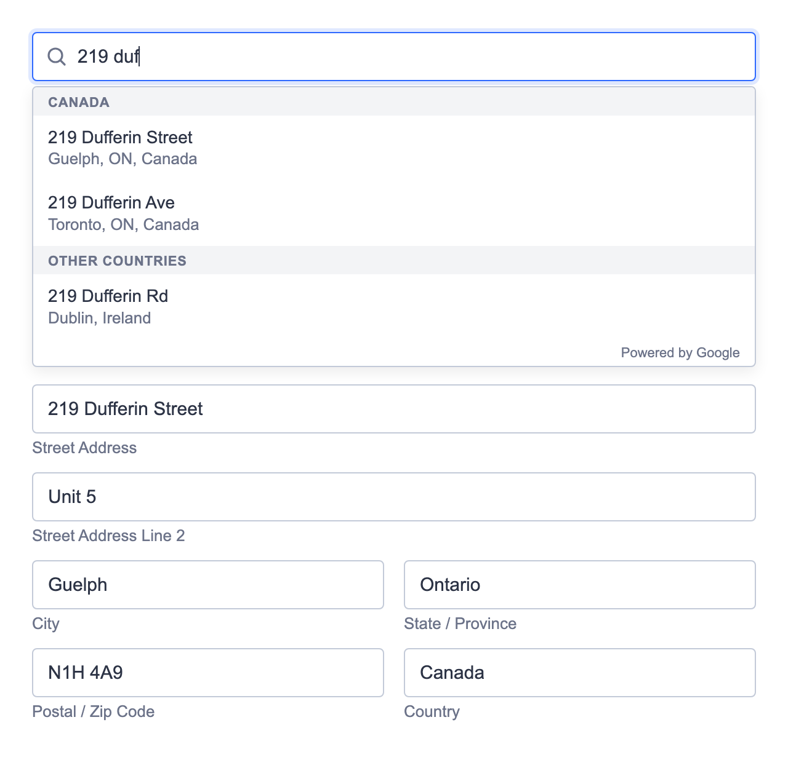

# Jotform Address Autocomplete Widget

A Jotform custom widget that finds addresses as you type (Google Places) and then splits the chosen address into standard fields: Street Address, Line 2, City, Province / State, Postal / Zip Code, and Country. It runs on Cloudflare Workers, which also calls Google on the widget's behalf, so **your Google API key never reaches the browser**.



## Features

- One search bar with suggestions from your home country first, then other countries.
- Picking a suggestion fills editable fields laid out like Jotform's built-in Address field. A "Can't find it? Enter address manually" link covers addresses Google doesn't know.
- Colours, font, sizes and labels are set from Jotform widget parameters, with no code changes. A `customCSS` parameter covers anything else.
- The Google key is stored as a Cloudflare secret. The widget page and its lookup API only respond inside a Jotform iframe.
- Saved submissions are readable text and load back into the fields when a submission is edited:

  ```
  Street Address: 219 Dufferin Street
  Street Address Line 2: Unit 206B
  City: Toronto
  Province / State: Ontario
  Postal / Zip Code: M6K 3J1
  Country: Canada
  ```

## How it works

```
Jotform form ──iframe──▶ your-domain/            widget page (public/index.html)
                              │
                              └─ fetch ──▶ your-domain/api/suggest   ─┐
                                           your-domain/api/place     ─┴─▶ Google Places API (New)
                                           (Cloudflare Worker, src/index.ts, holds the key)
```

## Setup

You need:

- A Cloudflare account with a domain on it, for example `address.example.com`.
- A Google Cloud project with **billing enabled** and **Places API (New)** enabled.
- Node.js 22.18 or later, and the [Cloudflare CLI](https://developers.cloudflare.com/cf/) (`npm install --global cf`, then `cf auth login`).

### 1. Get the code

```sh
git clone https://github.com/ar-va/jotform-address-autocomplete-google-maps.git
cd jotform-address-autocomplete-google-maps
npm install
```

### 2. Configure

In `cloudflare.config.ts`:

- `name`: any Worker name.
- `domains`: the address Jotform will load the widget from, on a domain in your Cloudflare account.
- `PRIMARY_COUNTRY`: two-letter country code listed first in suggestions (default `ca`).
- `API_RATE_LIMIT`: address lookups allowed per visitor per minute (default 30). A person filling in the form uses about 2–10.

In `src/index.ts`, `ALLOWED_HOSTS` lists the sites allowed to embed the widget. The default `jotform.com` covers `form.jotform.com`, `eu.jotform.com` and the form builder. Add your own domain if your forms use a Jotform custom domain.

### 3. Create a Google key for the server

In Google Cloud → APIs & Services → Credentials, create an API key:

- **API restrictions:** Places API (New) only.
- **Application restrictions:** None. The key is used from Cloudflare's servers, which have no fixed IP or website to restrict to. It's never sent to browsers.
- Recommended: set a daily request cap under Places API (New) → Quotas, so unexpected traffic can't run up a bill.

Copy `.dev.vars.example` to `.dev.vars` and paste the key in. `.dev.vars` is git-ignored; never commit it.

### 4. Deploy

```sh
cf deploy --secrets-file .dev.vars
```

This uploads the widget and the Worker, stores the key as a Cloudflare secret, and serves it on your domain. Later deploys can run plain `cf deploy` unless the key changes.

Opening the URL directly in a browser shows **Forbidden**. That's expected; it only loads inside a Jotform form.

### 5. Add it to Jotform

Create a custom widget in Jotform's widget developer area, set its URL to your domain (`https://address.example.com/`), and add it to a form. Add any of the optional parameters below as user parameters.

## Widget parameters

All parameters are optional. Leave one out or blank to keep the default. Sizes take a plain number (pixels) or any CSS length.

| Parameter | What it changes | Default |
| --- | --- | --- |
| `accentColor` | Focus outline, links | `#2e69ff` |
| `textColor` | Typed text | `#2c3345` |
| `labelColor` | Small labels under fields, hints | `#6c7389` |
| `borderColor` | Field borders | `#c3cad8` |
| `fieldBackground` | Field and dropdown background | `#ffffff` |
| `highlightColor` | Highlighted suggestion | `#eef3ff` |
| `fontFamily` | Font | Inter, system font |
| `fontSize` | Text size | `15` |
| `fieldHeight` | Field height | `40` |
| `cornerRadius` | Field corner rounding | `4` |
| `searchPlaceholder` | Search bar hint | Search for your address |
| `manualLinkText` | Manual-entry link | Can't find it? Enter address manually |
| `labelStreet`, `labelLine2`, `labelCity`, `labelProvince`, `labelPostal`, `labelCountry` | Field labels. These also name the lines in the submitted value. | Street Address, … |
| `customCSS` | Extra CSS added to the widget, e.g. `.field label { font-weight: 600 }`. Jotform's widget library applies a setting with this name too, so the widget's Custom CSS tab may work the same way. | empty |

The widget can't read your form's theme automatically (browsers keep an iframe from another site apart from the page around it), so set the colours to match your form's Form Designer.

## Local development

```sh
cf dev
```

The widget page still returns Forbidden when opened directly. To call the API locally, send `Sec-Fetch-Site: same-origin`, for example:

```sh
curl -H 'Sec-Fetch-Site: same-origin' 'http://localhost:5173/api/suggest?q=219+dufferin&session=11111111-2222-4333-8444-555555555555'
```

Google errors are logged by the Worker (`Google Places … failed: <status> <message>`). After deploying, view them in the Cloudflare dashboard under the Worker's logs.

## Security

What protects what:

- **Google key:** stored as a Cloudflare secret and only used by the Worker. It never appears in the page, the repo or the browser. Restrict it to Places API (New) and set a daily quota.
- **Widget page:** served only inside an iframe on `jotform.com` (`Sec-Fetch-Dest` check plus a `frame-ancestors` policy). Direct visits get 403. It also sends `nosniff`, `Referrer-Policy: same-origin`, a Permissions-Policy, and a CSP that blocks plugins, `<base>` tags and form posts.
- **Lookup API:** GET only, same-origin requests only, strict input checks (query length, session-token and place-ID formats), generic error messages, no caching, and a per-visitor rate limit. Google errors are logged server-side with query strings redacted, since they contain what people type.
- **Address text:** suggestions and labels are inserted as plain text, never as HTML, so a crafted address can't run code in the widget.
- **Allowed characters:** the search bar and fields accept only letters in any language (with accents), digits, spaces and `. , ' ’ # / & ( ) -`, up to 200 characters for search and 100 per field. Anything else is removed as it's typed or pasted, and the server rejects searches containing it. Saved values never start with `-`, so spreadsheets can't read an address as a formula.
- **Lookup limits:** when Google reports the daily quota is used up, the Worker stops calling Google for 10 minutes. The widget hides search, tells the person the limit is reached and opens the fields for manual entry. It checks this on load (`/api/status`, which doesn't use any Google quota) and whenever a search or the per-visitor rate limit fails.

Known limits:

- Header checks can be faked by scripts, and any Jotform account that knows your URL can embed the widget. The rate limit slows a single visitor down; many visitors working together could still use up the daily Google quota. **The quota cap is your hard cost limit.** If search stops working, check the Worker's logs for Google `429` errors.
- Script sources aren't restricted by the CSP, because Jotform's widget library loads its own theme scripts and fonts at runtime.
- Submitted addresses come from the respondent's browser, like any form field, so treat them as unverified input. Someone could bypass the widget's character rules with developer tools; the cleaning protects honest users and the spreadsheet case, not Jotform's own storage.
- Google requires the "Powered by Google" note in the suggestion list. Keep it. Google's terms also don't allow caching suggestions, which is why nothing is cached.

## Support

If this widget saved you time, you can buy me a coffee:

[](https://ko-fi.com/U7P1293ZXN)

## License

[MIT](LICENSE)
