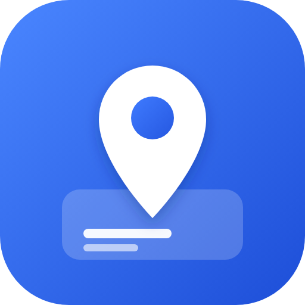
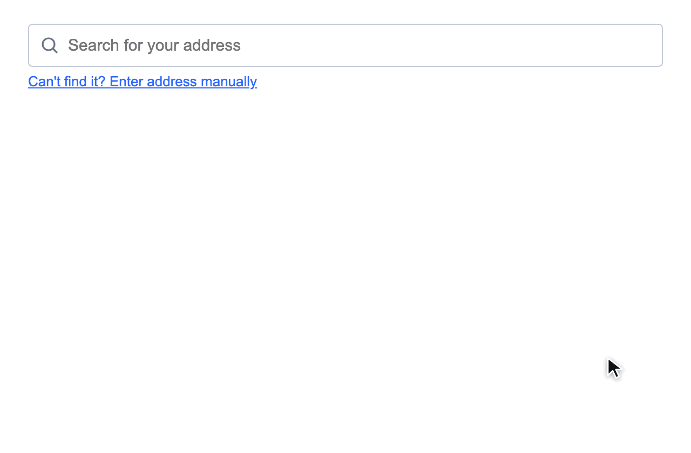

# Jotform Address Autocomplete Widget

An address field for [Jotform](https://www.jotform.com) forms. People start typing their address, pick it from Google's suggestions, and the widget fills in the standard address fields for them: street, unit, city, province or state, postal code and country.

You host it yourself, for free, on Cloudflare. Your Google key stays private on Cloudflare's side and never appears in your form.



## Contents

- [What it does](#what-it-does)
- [What you need](#what-you-need)
- [Set it up with an AI assistant](#set-it-up-with-an-ai-assistant)
- [Setup, step by step](#setup-step-by-step)
- [Customise the look and wording](#customise-the-look-and-wording)
- [Splitting the address into columns](#splitting-the-address-into-columns)
- [Troubleshooting](#troubleshooting)
- [Updating your widget later](#updating-your-widget-later)
- [Costs and limits](#costs-and-limits)
- [Security](#security)
- [For developers](#for-developers)

## What it does

- **Search as you type.** Suggestions come from Google Maps. You can limit searches to one country (for example Canada), with a "Not in Canada? Search all countries" link for visitors from elsewhere, or search the whole world.
- **Fills in the address for you.** Picking a suggestion fills editable fields laid out like Jotform's own Address field. A "Can't find it? Enter address manually" link is always there.
- **Matches your form.** Colours, font, sizes and labels are set from Jotform's widget settings, with no code changes.
- **Keeps working when limits are reached.** If the daily Google limit runs out, the widget quietly shows the regular address fields instead of the search, so visitors simply type their address. Anything they'd already typed carries over.
- **Clean submissions.** Each answer is saved as one formatted line, such as `219 Dufferin Street, Unit 206B, Toronto, Ontario M6K 3J1, Canada`. Need the parts in separate columns? See [Splitting the address into columns](#splitting-the-address-into-columns).

## What you need

| | What for | Cost |
| --- | --- | --- |
| A **Jotform** account | Where your forms live | Free plan works |
| A **Cloudflare** account | Hosts the widget | Free plan works |
| A **domain on Cloudflare** (for example `example.com`) | Gives the widget an address like `address.example.com`. No domain? See the note in [step 4](#4-tell-the-project-your-address). | You may already have one |
| A **Google Cloud** account with **billing turned on** | Address suggestions from Google Maps | Google includes a monthly free allowance; see [Costs and limits](#costs-and-limits) |
| A computer with **Node.js 22.18 or newer** | To upload the widget to Cloudflare | Free, from [nodejs.org](https://nodejs.org) (choose the LTS version) |

Plan for about 30–45 minutes the first time. You'll type a few commands into a **terminal**: on a Mac open the **Terminal** app; on Windows open **PowerShell**. Type or paste each command, then press Enter.

## Set it up with an AI assistant

If you use an AI coding assistant that can run commands on your computer (Claude Code, Cursor, GitHub Copilot in agent mode, or similar), you can let it do the technical parts. Copy this prompt into it:

```text
Help me set up my own copy of the Jotform Address Autocomplete widget from
https://github.com/ar-va/jotform-address-autocomplete-google-maps
by following its README. You can run commands on my computer; I'll do the
steps that need a browser or one of my accounts.

1. Check that Node.js 22.18 or newer is installed (if not, tell me how to
   install it). Get the project (git clone it, or tell me to download the ZIP),
   then run "npm install" and "npm install --global cf" in the project folder.
2. Run "cf auth login" and wait while I sign in to Cloudflare in my browser.
3. Ask me which address the widget should use: a subdomain of a domain in my
   Cloudflare account (for example address.example.com), or "workers.dev" if I
   don't have a domain. Create .env from .env.example with WIDGET_DOMAIN set to it.
4. Walk me through getting a Google Maps key (README step 3): billing on,
   Places API (New) enabled, the key restricted to Places API (New) only,
   application restrictions "None", and a daily quota.
5. Create .dev.vars from .dev.vars.example and let ME paste the key into it.
   Never ask me to paste the key into this chat, and never print, log or commit
   it. Check the file has one line starting with GOOGLE_MAPS_API_KEY= without
   showing the key.
6. Deploy with "cf deploy --secrets-file .dev.vars". If it fails, use the
   README's Troubleshooting section to fix it.
7. Check it works: a plain request to https://<my address>/ should get 403,
   and the same request with the header "Sec-Fetch-Dest: iframe" should get 200.
8. Walk me through README step 7 (creating the iFrame Widget in Jotform with my
   address as its URL) and step 8 (adding it to a form). Ask which optional
   settings I want (country, colours, labels) and tell me exactly what to enter.

Never commit or share .env or .dev.vars. Ask me before changing anything in my
Cloudflare or Google account other than the deploy itself.
```

It will still need you for the parts only you can do: signing in, creating the Google key, and clicking through Jotform. The steps below explain each of them if you'd rather do it yourself.

## Setup, step by step

### 1. Download the project

Easiest: on this page click the green **Code** button → **Download ZIP**, then unzip it somewhere you'll find it again, such as your Documents folder.

(If you use Git: `git clone https://github.com/ar-va/jotform-address-autocomplete-google-maps.git`)

### 2. Install the tools

In the terminal, go into the project folder. Type `cd` followed by a space, drag the unzipped folder onto the terminal window, and press Enter. Then run:

```sh
npm install
npm install --global cf
cf auth login
```

- `npm install` downloads what the project needs. Warnings are normal.
- `npm install --global cf` installs Cloudflare's command-line tool, `cf`.
- `cf auth login` opens your browser so you can sign in to Cloudflare and allow access.

### 3. Get a Google Maps key

In the [Google Cloud console](https://console.cloud.google.com):

1. Create or choose a project, and make sure **billing** is turned on for it (**Billing** in the left menu).
2. Go to **APIs & Services → Library**, search for **Places API (New)** and click **Enable**.
3. Go to **APIs & Services → Credentials → Create credentials → API key**. Then edit the key:
   - **API restrictions:** choose **Restrict key** and tick only **Places API (New)**.
   - **Application restrictions:** **None**. That's safe here: only your Cloudflare server uses the key, and it's never shown to visitors.
4. Recommended: **APIs & Services → Places API (New) → Quotas**, lower the **per day** limits (for example to 500). That caps your possible bill.

Copy the key; you'll need it in step 5.

### 4. Tell the project your address

Choose the address your widget will live at, on a domain in your Cloudflare account, for example `address.example.com`. Cloudflare creates it for you on the first upload; you don't need to set up DNS.

In the project folder there's a file called `.env.example`. Make a copy of it called `.env`:

```sh
cp .env.example .env        # Mac
copy .env.example .env      # Windows
```

Open `.env` in a text editor (TextEdit, Notepad, VS Code) and put your address after the `=` sign:

```
WIDGET_DOMAIN=address.example.com
```

This file stays on your computer, so your address isn't stored in the project's code.

> **No domain?** Use a free `workers.dev` address instead: write `WIDGET_DOMAIN=workers.dev`, and in the Cloudflare dashboard open **Workers & Pages** and pick your `workers.dev` subdomain if asked. Your widget address is shown after the upload in step 6.

**Only if your forms use your own domain** (a Jotform custom domain such as `forms.example.com`, instead of `form.jotform.com`): open `src/index.ts` and add it to the `ALLOWED_HOSTS` list near the top, like `["jotform.com", "example.com"]`. Otherwise leave that file alone.

### 5. Add your Google key

In the project folder there's a file called `.dev.vars.example`. Make a copy of it called `.dev.vars`:

```sh
cp .dev.vars.example .dev.vars        # Mac
copy .dev.vars.example .dev.vars      # Windows
```

Open `.dev.vars` in a text editor and paste your key right after the `=` sign, with no spaces or quotes:

```
GOOGLE_MAPS_API_KEY=AIzaSy...your-key...
```

Save it. Files starting with a dot are hidden on Mac; in Finder press **Cmd + Shift + .** to show them. This file stays on your computer and is never shared, even if you publish your copy of the project.

### 6. Upload the widget to Cloudflare

```sh
cf deploy --secrets-file .dev.vars
```

When you see **Deploy complete**, your widget is live, and the Google key is stored securely in Cloudflare.

**Check it:** open your widget address (for example `https://address.example.com`) in a browser. You should see **Forbidden**. That's correct: the widget only works inside a Jotform form. A brand-new address can take a few minutes to start working.

### 7. Create the widget in Jotform

1. Go to [jotform.com/widgets](https://www.jotform.com/widgets/), scroll down to **My Form Widgets** and click it.
2. At the bottom right, click **Add New Widget**.
3. Fill in the form:

| Field | What to enter |
| --- | --- |
| **Widget Icon** | Optional. Upload [`docs/icon-80.png`](docs/icon-80.png) (80×80). |
| **Widget Demo Screenshots** | Optional. You can use [`docs/screenshot.png`](docs/screenshot.png). |
| **Name** | Anything you'll recognise, e.g. `Address Autocomplete` |
| **Short Description**, **Description** | Optional, for your own reference |
| **Demo URL**, **Video URL** | Leave empty |
| **Categories** | **Mapping** |
| **Widget Type** | **iFrame Widget**. In the URL field that comes with it, enter your widget address, e.g. `https://address.example.com/` |
| **Static Widget** | **Leave unticked.** Ticked, the widget wouldn't save the address to the form. |
| **Accessible Widget (A11Y)** | Optional |
| **Multiple Instance** | Tick it if you want more than one address on the same form, e.g. billing and shipping |
| **Required By Default** | Optional; you can change it on each form anyway |
| **Default Label** | The question shown above the widget, e.g. `Home Address` |
| **Question Label** | Tick it to show that label on the form |
| **User Parameters** | Optional settings you can change per form (colours, labels, country). Click **Add Parameter** for each one; see [Customise the look and wording](#customise-the-look-and-wording). You can add them later. |
| **Under Review** | **Leave ticked** to keep the widget private: only you (and Jotform's admins) can see and use it |
| **Disabled** | Leave unticked |

4. Click **Add**.

### 8. Add it to a form

In the form builder, add your widget like any other field and give it a label such as "Home Address". Open the form's preview, type an address, and pick a suggestion. Done!

## Customise the look and wording

Each setting below is a **User Parameter** you add to your widget in Jotform (**My Form Widgets** → your widget → **Add Parameter**, see step 7). Once added, you change its value per form in the widget's **Settings → General** tab. Every one is optional: anything you don't add, or leave empty, keeps the default.

When adding a parameter, fill in:

- **Name:** exactly as in the table. Capital letters matter.
- **Human Readable Name:** any label you like; it's what you'll see in the settings panel.
- **Field Type:** as in the table.
- **Default Value:** see the table. Leave **Conditional Rendering** empty.

| Name | What it changes | Field Type | Default Value |
| --- | --- | --- | --- |
| `searchCountry` | Country searched first. As its options, paste the list from [`docs/countries.txt`](docs/countries.txt). Visitors can still switch to all countries. | Dropdown | `All countries` (search everywhere) or e.g. `Canada (CA)` |
| `accentColor` | Highlight around the active field, links | Color | `#2e69ff` |
| `textColor` | Typed text | Color | `#2c3345` |
| `labelColor` | Small labels under the fields | Color | `#6c7389` |
| `borderColor` | Field borders | Color | `#c3cad8` |
| `fieldBackground` | Inside of the fields | Color | `#ffffff` |
| `highlightColor` | Suggestion under the mouse | Color | `#eef3ff` |
| `fontFamily` | Font, e.g. `Inter, sans-serif` | Text | leave empty |
| `fontSize` | Text size in pixels, e.g. `15` | Text | leave empty |
| `fieldHeight` | Field height in pixels, e.g. `40` | Text | leave empty |
| `cornerRadius` | Field corner rounding in pixels, e.g. `4` | Text | leave empty |
| `searchPlaceholder` | Hint in the search bar | Text | leave empty |
| `manualLinkText` | "Can't find it? Enter address manually" | Text | leave empty |
| `labelStreet` `labelLine2` `labelCity` `labelProvince` `labelPostal` `labelCountry` | The labels under each field, e.g. for another language | Text | leave empty |
| `customCSS` | Anything else, as CSS, e.g. `.field label { font-weight: 600 }` | Textarea | leave empty |

Tips:

- **Colour settings say "undefined"?** Jotform only applies Default Values when the widget is added to a form. Delete the widget from the form and add it again. Do this before you collect real submissions.
- **Matching your form's colours:** the widget can't read your form's theme by itself, so copy the colours from your form's **Form Designer** into the colour settings.

## Splitting the address into columns

Jotform stores one answer per widget, so each submission has one column with the full address, for example:

`219 Dufferin Street, Unit 206B, Toronto, Ontario M6K 3J1, Canada`

To get street, city and so on as separate columns, split them after exporting your submissions:

- **Excel:** select the address column → **Data → Text to Columns** → **Delimited** → tick **Comma**.
- **Google Sheets:** in an empty column, use `=SPLIT(B2, ", ", FALSE)` (replace `B2` with the address cell), or **Data → Split text to columns**.

Parts that were left empty are skipped, so an address without a unit has one column fewer. Check the columns line up before you sort or mail-merge.

**Editing a submission** opens the widget with the saved address shown in the search bar. It's kept exactly as saved unless you pick or type a new address.

## Troubleshooting

**Opening the widget address shows "Forbidden".**
That's normal. The widget only loads inside a Jotform form. Test it through your form's preview.

**No suggestions appear, or the widget shows only the address fields (no search bar).**
Most often Google's daily limit is used up. Check **Google Cloud → APIs & Services → Places API (New) → Quotas**. The limit resets at midnight Pacific Time. You can raise it there; that needs billing turned on. Also check that **billing** is active and **Places API (New)** is enabled. For the exact reason, open the **Cloudflare dashboard → Workers & Pages → your widget → Observability** and look for `Google Places … failed` messages.

**The upload (`cf deploy`) fails.**
Read the message:

- "WIDGET_DOMAIN is not set": create the `.env` file from step 4.
- "workers.dev subdomain": set your own domain in `.env` (step 4), or pick a `workers.dev` subdomain in the Cloudflare dashboard.
- Anything about the domain: check it's spelled correctly and that the domain is in your Cloudflare account.
- Not signed in: run `cf auth login` again.

**Search worked, then stopped after I changed my Google key.**
Put the new key in `.dev.vars` and run `cf deploy --secrets-file .dev.vars` again.

**The widget looks cut off or too tall in the form.**
It resizes itself as you use it. If it doesn't, check that the widget's URL in Jotform is exactly your widget address.

## Updating your widget later

After changing any file (including downloading a newer version of this project), upload again from the project folder:

```sh
cf deploy
```

Your Google key stays stored in Cloudflare, so you only need `--secrets-file .dev.vars` when the key changes.

<details>
<summary><strong>Optional: deploy automatically from your own GitHub copy</strong></summary>

If you keep your copy of the project on GitHub, Cloudflare can redeploy whenever you push changes:

1. Cloudflare dashboard → **Workers & Pages** → your widget → **Settings → Builds → Connect**.
2. Choose GitHub and give access to **only that repository**.
3. Branch `main`, **Build command** empty, **Deploy command** `npx cf deploy`, **Preview builds** off.
4. Under **Build variables**, add `WIDGET_DOMAIN` with your widget address (the same value as in your `.env`). Mark it as a secret if you'd rather not show it in the dashboard.

Your Google key and your address stay in Cloudflare; never put them in the repository.

</details>

## Costs and limits

- **Cloudflare:** the free plan is enough for a form widget.
- **Google:** each search a visitor makes (they search as they type) is one request, and picking an address is one more. A typical visitor uses about 2–5 searches. Google includes a monthly free allowance for Places API (New), but pricing changes, so check [Google Maps Platform pricing](https://mapsplatform.google.com/pricing/). **Set a daily quota** (step 3) so a surprise can't run up a bill. For example, 100 requests a day covers roughly 20–50 visitors.
- **Per-visitor limit:** each visitor can make up to 30 lookups a minute, so one person (or a script) can't use up your quota. Change it in `cloudflare.config.ts` (`API_RATE_LIMIT`).

## Security

In short:

- **Your Google key is never exposed.** It's stored as a Cloudflare secret and used only by your Cloudflare server. It isn't in the widget, the form or this repository.
- **The widget only runs inside Jotform forms.** Opening it directly, or embedding it on another website, is blocked.
- **Typing is filtered.** The fields accept letters (any language, with accents), numbers, spaces and `. , ' ’ # / & ( ) -`; postal codes accept only letters, numbers, spaces and `-`. Anything else is removed, so pasted code or spreadsheet formulas can't sneak into submissions. The server double-checks searches.
- **Length limits:** search 200 characters, street and line 2 100, city 80, province or state 60, postal code 12, country 60. Values from Google are trimmed to fit.
- **Abuse is limited.** The per-visitor limit and your Google daily quota cap how much anyone can use. When a limit is reached, the widget quietly switches to plain address fields.

<details>
<summary><strong>Details for technical readers</strong></summary>

- **Widget page:** served only for `Sec-Fetch-Dest: iframe` (with a `jotform.com` Referer fallback for older browsers) and a CSP `frame-ancestors` restricted to `jotform.com`. Direct visits get 403, and only GET/HEAD is allowed. It also sends `nosniff`, `Referrer-Policy: same-origin`, a Permissions-Policy, and a CSP blocking plugins, `<base>` and form posts. Script sources aren't restricted, because Jotform's widget library loads its own theme scripts and fonts at runtime.
- **Lookup API:** GET only and same-origin only (`Sec-Fetch-Site`). Strict checks on query characters and length, session-token and place-ID format, and country codes. Generic error messages, `Cache-Control: no-store`, and a per-IP rate limit (Workers rate-limiting binding). Google calls time out after 5 s.
- **Quota handling:** on a Google 429 the Worker stores a 10-minute flag in the Cache API and answers `quota_exceeded` without calling Google. `/api/status` lets the widget show plain address fields on load without using quota. No message is shown to visitors.
- **Output:** suggestions and labels are inserted with `textContent`, never as HTML. Saved values never start with `-`.
- **Logging:** Google errors are logged server-side with query strings redacted, since they contain what people type.
- **Known limits:** headers can be forged by scripts, and any Jotform account that knows your URL can embed the widget. The rate limit slows a single source down; distributed abuse is capped by your Google quota. Submissions come from the visitor's browser like any form field, so treat them as unverified input.
- **Google terms:** keep the "Powered by Google" note in the suggestion list. Suggestions aren't cached, because Google's terms don't allow it.

</details>

## For developers

<details>
<summary><strong>How it works, project layout and local development</strong></summary>

```
Jotform form ──iframe──▶ your-domain/              widget page (public/index.html)
                              │
                              ├─ fetch ──▶ /api/status     quota state, no Google call
                              ├─ fetch ──▶ /api/suggest    ─┐
                              └─ fetch ──▶ /api/place      ─┴─▶ Google Places API (New)
                                           Cloudflare Worker (src/index.ts) holds the key
```

| File | What it is |
| --- | --- |
| `public/index.html` | The widget page: HTML, CSS and JavaScript in one file, no build step |
| `src/index.ts` | The Cloudflare Worker: page gating, lookup API, Google calls |
| `cloudflare.config.ts` | Worker name, bindings (assets, secret, rate limit); reads your address from `WIDGET_DOMAIN` |
| `.env.example` | Template for `.env`, which holds your widget address |
| `docs/countries.txt` | Options for the `searchCountry` dropdown |
| `.dev.vars.example` | Template for the local secrets file |

API:

- `GET /api/suggest?q=&session=&country=&scope=` returns `{ country, countryName, scope, groups: [{ label, items: [{ id, main, secondary, text }] }] }`. `country` is a two-letter code, or omitted to search everywhere; `scope=world` searches everywhere even with a country set.
- `GET /api/place?id=&session=` returns `{ streetNumber, route, unit, city, province, postalCode, country }`.
- `GET /api/status` returns `{ search: "ok" | "limited" }`.
- Errors return `{ error }`, one of `bad_request`, `forbidden`, `rate_limited`, `quota_exceeded`, `lookup_failed`, `not_configured`.

Run locally (uses the key in `.dev.vars`):

```sh
cf dev
```

The page still returns 403 when opened directly. To call the API, send the header a browser would:

```sh
curl -H 'Sec-Fetch-Site: same-origin' 'http://localhost:5173/api/suggest?q=219+dufferin&country=ca&session=11111111-2222-4333-8444-555555555555'
```

Type-check with `npx tsc --noEmit`.

</details>

## Support

If this widget saved you time, you can buy me a coffee:

[](https://ko-fi.com/U7P1293ZXN)

## License

[MIT](LICENSE): free to use, change and share.
